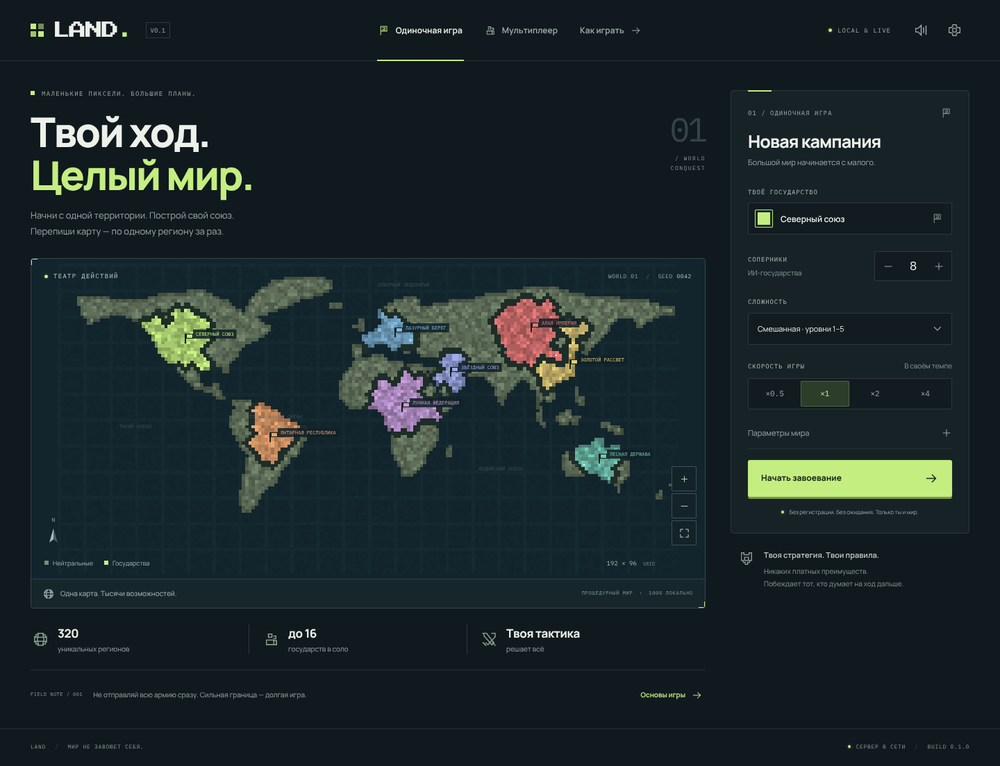
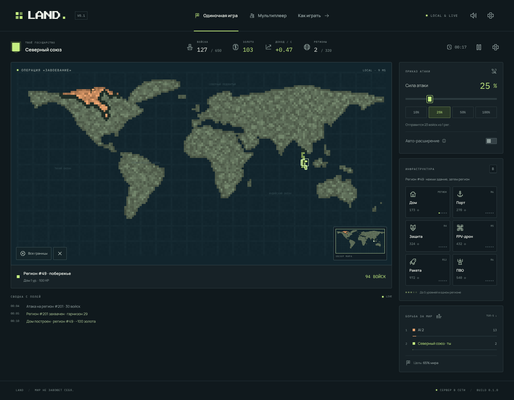

# LAND · V0.1

**Пиксельная стратегия захвата территорий.** Один мир, до 20 государств, авторитетный Node.js-сервер и клиент без сборщика. Интерфейс на русском, все шрифты и звуки локальные/процедурные, внешних CDN нет.



## Быстрый старт

Требуется **Node.js ≥ 20**.

```bash
npm install
npm start
```

Открыть **http://localhost:3000**. WebSocket работает на том же порту: `/ws`. Сервер слушает `0.0.0.0`, порт можно задать через `PORT`:

```bash
PORT=8080 npm start
```

Сборка клиента не нужна: браузер загружает ES-модули напрямую. Для разработки с перезапуском сервера: `npm run dev`.

## Что уже playable

- **Карта мира:** стандартная 192×96 / 320 регионов и большая 256×128 / 340 регионов. Узнаваемые континенты, связные регионы-«пиксели», берега и морские проливы.
- **Соло:** 1–15 ИИ, сложность 1–5 или смешанная, скорость ×0.5/×1/×2/×4, seed, мирная застройка 0/10/30 с, множитель старта, лимит времени и процент победы.
- **Мультиплеер:** комнаты по 6-символьному коду, список открытых комнат, до 20 слотов, боты-заполнители, хост-контролы, чат, отсчёт 3-2-1, реконнект 90 секунд.
- **Атака 0–100%:** выбор одного/нескольких регионов, прямоугольное выделение, мазок, все границы, пресеты и хоткеи. 0% не запускает атаку. 100% отправляет весь гарнизон выбранных источников.
- **Экономика:** рост войск, лимит, золото, торговля портов, оверлимит без сгорания излишка.
- **6 построек:** дом, порт, защита, FPV-дрон, ракета, ПВО. Наложение до 5 уровней, рост цен, захват целой/повреждённой/разрушенной постройки, отсутствие авторегена HP.
- **Бой и оружие:** волны с задержкой по расстоянию, гарнизоны, форты, морские десанты, авто-расширение, дроны, баллистические ракеты, перехват ПВО.
- **UI:** пиксельный стиль, Canvas 2D, миникарта, лидерборд, лог событий, экран результата, реванш, туториал, настройки звука, режим узоров границ для дальтоников.
- **Звук:** процедурный Web Audio API, пространственная громкость/панорама, лимит боевых голосов, микшер master/SFX/music, mute в `localStorage`. Музыкальный луп по умолчанию выключен.
- **Адаптивность:** от 360 px до 4K; в портрете карта сверху, команды в нижнем доке; touch drag/pinch/tap/long-press/double-tap.



## Управление

| Действие | Мышь / клавиатура | Touch |
|---|---|---|
| Выбрать свой регион | клик | tap |
| Все пограничные регионы | двойной клик | long-press / двойной tap по своему |
| Атака | выбрать источники → клик по соседу | tap по цели |
| Прямоугольное выделение | `Shift + drag` | — |
| Выделение мазком | `Alt + drag` | — |
| Панорама | drag / `WASD` / стрелки | drag / два пальца |
| Зум | колесо / `Q` `E` | pinch |
| Сила атаки | ползунок / `1..5` = 20/40/60/80/100% | ползунок / пресеты |
| Пауза / меню | `Space` / `Esc` | кнопки |
| Постройки / лидерборд | `B` / `Tab` | панели |
| FPS и бюджет кадра | `F3` | — |
| Отмена выделения/постройки | ПКМ | кнопка сброса |

Постройка: выбери **один** свой регион → нажми здание → нажми регион на карте. Повторное наложение того же типа улучшает его до 5 уровня. Порт ставится только на берег.

## Баланс

Все числа баланса находятся в **`config/balance.js`**; корневой `config.js` реэкспортирует их. Формулы — в `shared/formulas.js`, логика не содержит разбросанных магических чисел.

| Величина | Значение / формула |
|---|---|
| Прирост войск/с | `0.30 * regions^0.92 * (1 + 0.03 * houseLevels)` |
| Лимит войск | `300 + 350 * houseLevels` |
| Доход экономики/с | `0.06 * regions + 0.35 * houseLevels` |
| Доход торговли/с | `0.5 * portLevels * (1 + 0.05 * regions / 100)` |
| Старт | 1 регион, 40% базового лимита = 120 войск, 200 золота |
| Нейтральный захват | `(1 + 0.5 * defenderTroops) * sqrt(area / averageArea)` |
| Цена постройки | `baseCost * 1.08^totalBuildingsOwned` |
| Апгрейд до `L` | `baseCost * 1.6^(L-1) * 1.08^totalBuildingsOwned` |
| Лечение апгрейдом | `+50% maxHP нового уровня`, не выше максимума |
| Волна атаки | `0.25 + 0.05 * distance` секунд; форт ×1.5 по суше |
| Форт | сила атаки ×`(1 − 0.08·L)`, защита ×`(1 + 0.10·L)` |
| Порт | переход через воду ≤6 клеток, +15% силы десанта за уровень |

| Постройка | Цена | HP/уровень | Радиус | Перезарядка / эффект |
|---|---:|---:|---:|---|
| Дом | 100 | 100 | регион | +350 лимита, +3% роста, +0.35 золота/с за уровень |
| Порт | 250 | 120 | 6 | +0.5 торговли/с за уровень, десант |
| Защита | 300 | 150 | 4 | замедление и снижение силы атаки, бонус гарнизону |
| FPV-дрон | 400 | 80 | 5 | каждые 20 с: `25 × L` урона инфраструктуре |
| Ракета | 900 | 60 | 12 | каждые 60 с: полёт 2.5 с, `120 × L` урона, splash 1.5 |
| ПВО | 500 | 100 | 6 | каждые 8 с: до `L` дронов; ракета `min(90%, 25% × L)` |

Захват постройки бросается отдельно для каждой постройки. В V0.1 явная формула оставшегося HP имеет приоритет: `pDestroy = clamp(0.25 − 0.15 × HP/maxHP, 0.05, 0.6)`, повреждение — 35%, остальное — целая. Опциональный коэффициент `capture.overkillWeight` по умолчанию `0`; его можно включить для более разрушительного правила. Три исхода логируются.

## Проверки

```bash
npm test                         # 23 node:test-теста: формулы, бой, цены, уровни, карта, протокол, комнаты, оружие, WebSocket
npm run check                    # синтаксис всех модулей, gzip-бюджет клиента, отсутствие CDN, проверка карт
npm run sim -- --ai 8 --minutes 5 --seed 42
npm run sim -- --ai 8 --minutes 5 --seed 42 --speed 4 --verify
npm run map                      # детерминированная регенерация map.json и map-large.json
```

Headless-симуляция создаёт одного idle-игрока и `--ai` ботов, гоняет фиксированные тики без браузера, проверяет инварианты и печатает итоговую таблицу. `--verify` дополнительно сравнивает два запуска с тем же seed. Матч завершается захватом заданного процента мира, доминацией или по лимиту времени.

Опциональный browser smoke test (Linux, сервер уже запущен):

```bash
node tools/browserSmoke.js
```

Он проверяет соло-захват и дом, два браузерных контекста в одной комнате, чат, реконнект, портрет 360 px и отсутствие ошибок консоли. Скриншоты сохраняются в `docs/`. Браузерный бинарник берётся из npm-пакета, не из CDN.

## Архитектура коротко

- `server/rooms/gameRoom.js` — изолированная симуляция: очередь намерений, фиксированный тик 20 Гц, seed RNG, команды, волны, оружие, результат.
- `server/rooms/roomManager.js` — комнаты, сессии, снапшоты 10/с, TTL, реконнект, graceful shutdown.
- `server/ai/aiController.js` — утилитарный ИИ; ходит только теми же валидируемыми командами, без читов.
- `shared/` — формулы, протокол, RNG и JSON-карты, общие для клиента и сервера.
- `client/render/renderer.js` — offscreen `ImageData`, грязные регионы, предвычисленные границы, камера, minimap, пул частиц, волны/снаряды.
- `client/audio/audioEngine.js` — процедурный синтез, микшер, spatial audio, autoplay после первого действия.
- `client/ui/network.js` — WebSocket, `cmdId`, повторы, ping, reconnect banner.

Сеть: компактные JSON-дельты. Полные строки регионов отправляются для видимой области, своих регионов и границы; вне интереса — сводка владельца. Это не туман войны: владельцы на миникарте видны всем. При смене viewport клиент получает полный срез.

## Принятые допущения

1. **Без сборщика:** чистый ES-модульный JS + Canvas 2D + CSS. Это разрешённая brief альтернатива TypeScript/Vite и даёт `npm start` без шага сборки.
2. **Карта:** континенты рисуются вручную в `tools/buildMap.js`, затем растрируются и разбиваются watershed-регионами. Seed матча детерминированно выбирает столицы, ИИ и броски захвата; геометрия карты фиксирована для воспроизводимого реванша.
3. **Большая карта:** 256×128, 340 регионов; радиусы оружия/портов масштабируются относительно 192-клеточной базы. Экономика не масштабируется.
4. **Победа:** по умолчанию 65% мира или лидерство к концу 10 минут. В настройках доступны 50/65/80/100% и 1/5/10/20/60 минут.
5. **Гарнизон:** при неудачной атаке защитник сохраняет остаток гарнизона. Это разрешает противоречие brief «теряет весь / остаётся с остатком» в пользу непрерывного боя.
6. **Захват построек:** явная формула HP важнее неоднозначного предложения про overkill; см. раздел баланса. Захваченные постройки начинают давать экономический эффект со следующего тика.
7. **Реконнект:** слот живёт 90 с, затем становится ботом уровня 3. Явный выход передаёт страну боту сразу. Пустое лобби живёт 60 с; матч без людей удаляется после окна реконнекта + TTL.
8. **Статистика:** только анонимный локальный JSON (`data/profiles.json`, игнорируется Git). Аккаунтов, Elo и рейтинга нет.
9. **Производительность:** код клиента ≈43 KiB gzip без карты/шрифтов; DPR ≤2, деградация частиц/шума при FPS <45 дольше 3 с, пауза рендера в скрытой вкладке. 60 FPS на конкретном телефоне требует замера на устройстве; headless software-renderer не является мобильным бенчмарком.

Подробнее: [`docs/DESIGN.md`](docs/DESIGN.md). Чек-лист приёмки: [`docs/ACCEPTANCE.md`](docs/ACCEPTANCE.md).

## Структура

```text
config.js                  # публичный вход в баланс
config/balance.js          # все числа баланса
shared/                    # формулы, протокол, RNG, map/*.json
server/index.js            # HTTP + REST + /ws, 0.0.0.0:PORT
server/rooms/              # GameRoom + RoomManager
server/sim/                # экономика, бой, постройки/оружие
server/ai/                 # утилитарный ИИ
client/index.html          # экраны и HUD
client/main.js             # orchestration, input, экраны
client/render/             # Canvas 2D, камера, minimap, эффекты
client/ui/                 # HUD, сеть, DOM-хелперы
client/audio/              # Web Audio синтез
client/assets/fonts/       # локальные woff2 + лицензии
tools/buildMap.js          # генератор карт
tools/simulate.js          # headless-матч
tools/check.js             # статические проверки
tools/browserSmoke.js      # опциональный браузерный smoke test
tests/                     # node:test
docs/                      # дизайн, приёмка, скриншоты
```

## TODO V0.2

Аккаунты и Elo; дипломатия/союзы; туман войны; дополнительные карты и сценарии; редактор карт; реплеи; PWA; кастомизация флага/герба; достижения; магазин; настоящий мастер-процесс с несколькими игровыми воркерами и Redis pub/sub для лобби; бинарный протокол; более строгий interest management; мобильные замеры FPS и профилирование памяти.

## Лицензии шрифтов

Локальные шрифты: Press Start 2P, Manrope, IBM Plex Mono. Тексты лицензий лежат рядом с woff2 в `client/assets/fonts/LICENSE-*.txt`.
